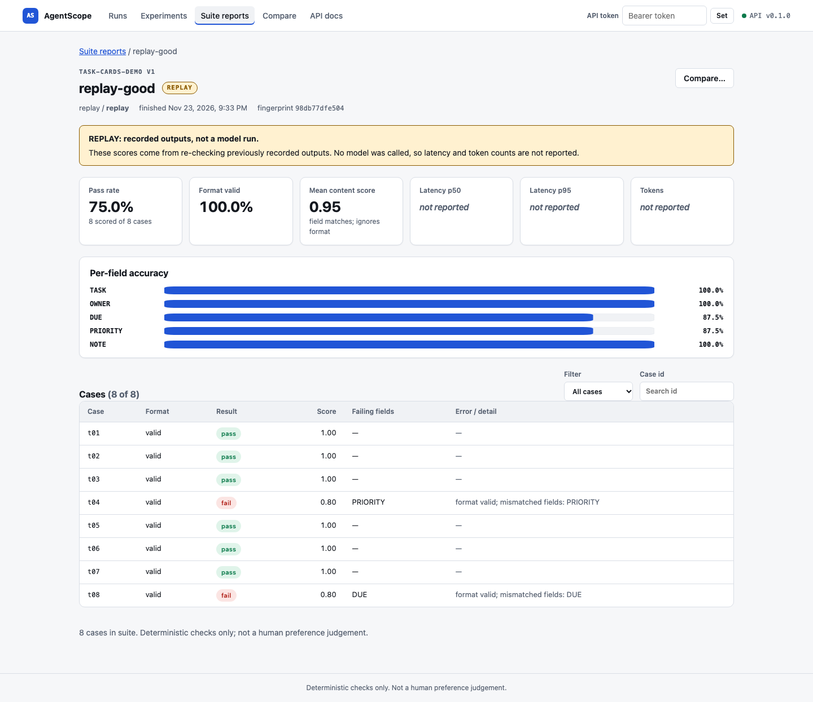
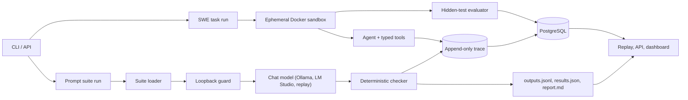
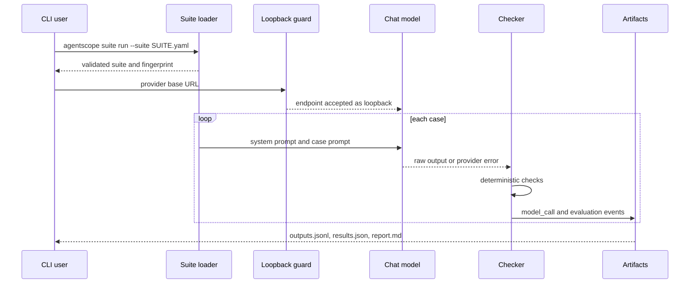
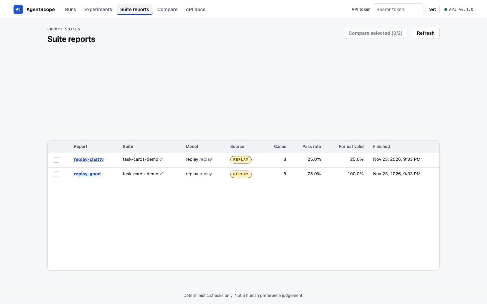
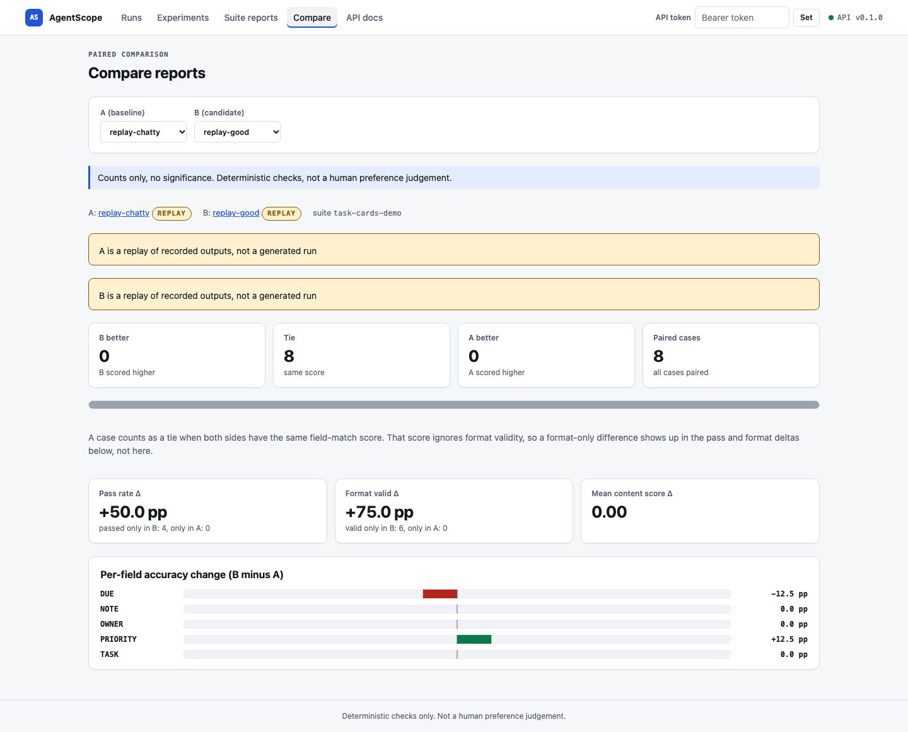

# AgentScope

[](https://github.com/aditsinsinwal/AgentScope/actions/workflows/ci.yml)  

**Evaluate how AI agents behave, fail, and recover.**

<picture>
  <source media="(prefers-color-scheme: dark)" srcset="docs/images/dashboard-detail-dark.png">
  
</picture>

*Report detail view of the replay demo in `examples/suites/task-cards/`. It shows recorded outputs
re-scored by deterministic checks. It is not a model benchmark, and no model was called.*

> Status: v0.1 engineering MVP. Implemented: the SWE-task engine (Docker sandbox, hidden-test
> evaluation, traces, replay, experiments, faults), a PostgreSQL schema, a versioned API, and
> prompt-suite evaluation with deterministic checkers, loopback-only local model providers,
> paired comparison, and a dashboard. Distributed operation remains intentionally minimal. No
> benchmark or performance result is claimed in this repository.

## Why AgentScope

- **Deterministic checks first.** Outputs are scored by exact, regex, field-format and JSON-key
  checkers. There is no LLM judge, so the same outputs always produce the same scores.
- **Models and harnesses are separate.** Experiments hold the task version and seed fixed and vary
  one configuration axis at a time, so a tool improvement is not reported as a model improvement.
- **Reproducible by construction.** Runs are fingerprinted (task hash, agent, model, prompt,
  generation settings, checker, case bytes). Fault injection is seeded. Comparisons refuse
  mismatched fingerprints unless explicitly overridden.
- **Append-only traces and replay.** Every model call and tool call is recorded as an event, and
  recorded runs can be replayed and re-scored offline.
- **Sandbox isolation for untrusted code.** Each SWE run gets a fresh, network-disabled, resource-limited
  Docker container. Hidden tests run in a second container after the agent container is destroyed.
- **Local-first, loopback-only.** The Ollama and LM Studio providers default to `127.0.0.1` and the
  loopback guard applies to every base URL. It rejects lookalike hosts, userinfo and non-loopback
  addresses before any request is sent.

## Two evaluation modes

| | SWE tasks | Prompt suites |
|---|---|---|
| Unit under test | A coding agent repairing a repository | A chat model answering a prompt set |
| Isolation | Ephemeral Docker sandbox per run | Local process, loopback endpoint only |
| Input | YAML task, repository, public and hidden tests | `suite.yaml` plus a JSONL cases file |
| Scoring | Fixed 70 / 15 / 10 / 5 point rubric (below) | `exact`, `regex`, `field_lines`, `json_keys` checkers |
| Output | Run record, trace, evaluation result in PostgreSQL or JSONL | `outputs.jsonl` for blind human A/B, `results.json`, `trace.jsonl`, `report.md` |
| Compare | Experiment matrix and aggregate report | `suite compare` on paired cases, fingerprint-checked |
| Doc | [evaluation](docs/evaluation.md), [sandboxing](docs/sandboxing.md) | [prompt suites](docs/prompt-suites.md) |

## Architecture



A prompt-suite run, step by step:



## Try it in 60 seconds (no Docker, no API key)

The repository ships a synthetic task-card suite (8 cases) with two recorded output files. The
`replay` provider serves those recorded outputs instead of calling a model, so the scoring path runs
end to end with nothing to install beyond the Python package. Run from the repository root after
`pip install -e '.[dev]'`:

```bash
agentscope suite run --suite examples/suites/task-cards/suite.yaml --provider replay \
  --replay-outputs examples/suites/task-cards/replay-good.outputs.jsonl --out artifacts/demo/good

agentscope suite run --suite examples/suites/task-cards/suite.yaml --provider replay \
  --replay-outputs examples/suites/task-cards/replay-chatty.outputs.jsonl --out artifacts/demo/chatty

agentscope suite compare artifacts/demo/chatty/results.json artifacts/demo/good/results.json
```

Real output, captured by running these commands in this repository (the `Artifacts:` lines are
omitted for brevity):

```text
$ agentscope suite run ... --replay-outputs examples/suites/task-cards/replay-good.outputs.jsonl ...
Suite: task-cards-demo v1  fingerprint 98db77dfe504
Source: replay  Model: replay
Cases: 8 (8 scored, 0 failed)
Format valid: 100.0%  Passed: 75.0%
  TASK: 100.0%
  OWNER: 100.0%
  DUE: 87.5%
  PRIORITY: 87.5%
  NOTE: 100.0%
Deterministic checks only; not a human preference judgement.

$ agentscope suite run ... --replay-outputs examples/suites/task-cards/replay-chatty.outputs.jsonl ...
Suite: task-cards-demo v1  fingerprint 98db77dfe504
Source: replay  Model: replay
Cases: 8 (8 scored, 0 failed)
Format valid: 25.0%  Passed: 25.0%
  TASK: 100.0%
  OWNER: 100.0%
  DUE: 100.0%
  PRIORITY: 75.0%
  NOTE: 100.0%
Deterministic checks only; not a human preference judgement.

$ agentscope suite compare artifacts/demo/chatty/results.json artifacts/demo/good/results.json
warning: A is a replay of recorded outputs, not a generated run
warning: B is a replay of recorded outputs, not a generated run
Suite: task-cards-demo
Paired cases: 8 (unpaired: 0); B better: 0, tie: 8, A better: 0
Format valid only in B: 6, only in A: 0; passed only in B: 4, only in A: 0
Format valid rate delta (B - A): +75.0 pp
Pass rate delta (B - A): +50.0 pp
Mean score delta (B - A): +0.000
  DUE accuracy delta: -12.5 pp
  NOTE accuracy delta: +0.0 pp
  OWNER accuracy delta: +0.0 pp
  PRIORITY accuracy delta: +12.5 pp
  TASK accuracy delta: +0.0 pp
Counts only; no significance is claimed. Not a human preference judgement.
```

Read the two runs together: every paired case ties on field-match score, but the chatty run
answers in the wrong shape for 6 of 8 cases. The format and content views are reported separately
because they measure different things.

Full run output, including `suite validate` and a loopback rejection example, is in
[docs/prompt-suites.md](docs/prompt-suites.md#worked-example-no-network-no-model).

## Quick start (SWE tasks, Docker)

Python 3.12 and Docker are required for isolated runs.

```bash
python3.12 -m venv .venv
source .venv/bin/activate
pip install -e '.[dev]'
docker build -t agentscope-sandbox:py312 -f sandbox/Dockerfile .
docker compose up -d postgres
alembic upgrade head
```

Run the example with a deterministic mock action script:

```json
[
  {
    "tool": "replace_text",
    "arguments": {
      "path": "cart.py",
      "old": "    total = sum(items)",
      "new": "    if not items:\n        return {\"status\": \"empty\", \"total\": 0}\n    total = sum(items)",
      "expected_replacements": 1
    }
  }
]
```

```bash
agentscope run --task examples/cart-empty-500/task.yaml --agent mock \
  --mock-actions actions.json --sandbox docker
agentscope replay run_ab12cd34ef56
agentscope serve --sandbox docker
```

`--sandbox local` is convenient for harness development, but it executes code as a host process
and is never a security boundary.

## Dashboard

The dashboard is a React + Vite single-page app served by `agentscope serve`. It has four views:
suite reports, report detail, paired compare, and the original SWE-task runs and experiments.

```bash
AGENTSCOPE_REPORTS_DIR=artifacts/suite-reports agentscope serve --sandbox local
# open http://127.0.0.1:8000/
```

`./scripts/start-dashboard.sh` starts the same server with sensible defaults. Set
`AGENTSCOPE_SANDBOX=docker` when evaluating untrusted task code.

Suite reports list, from the replay demo:



Compare view (`replay-chatty` as A, `replay-good` as B). It shows counts and deltas only:



See [docs/dashboard.md](docs/dashboard.md) for routes, the reports directory contract and the
API token field.

## Engineering quality

- **CI** ([`ci.yml`](.github/workflows/ci.yml)): a Python job on 3.12 and 3.13 that runs `ruff check`,
  `ruff format --check`, `mypy agentscope` (strict) and `pytest` with the coverage gate, plus a
  frontend job that runs `npm run typecheck`, `npm test` and `npm run build`.
- **Coverage gate**: branch coverage with `fail_under = 70` in `pyproject.toml`.
- **Measured at commit `d606465`** (the commands below were run on that commit):

<details>
<summary>Commands and output</summary>

```text
$ .venv/bin/pytest --cov=agentscope 2>&1 | tail -3
1 empty file skipped.
Required test coverage of 70.0% reached. Total coverage: 82.39%
193 passed, 2 skipped, 1 warning in 6.89s

$ cd frontend && npm ci --silent && npm test 2>&1 | tail -5
 Test Files  3 passed (3)
      Tests  15 passed (15)

$ .venv/bin/ruff check . | tail -1
All checks passed!
$ .venv/bin/ruff format --check . | tail -1
123 files already formatted
$ .venv/bin/mypy agentscope | tail -1
Success: no issues found in 66 source files
```

</details>

Result: 193 Python tests passing (2 skipped by default; opt-in Docker and PostgreSQL integration
tests are excluded), 82.39% branch coverage against a 70% gate, and 15 frontend tests in 3 files.

### Robustness

- Provider calls retry transport errors, HTTP 429 and 5xx with exponential backoff and jitter,
  honouring `Retry-After` up to a cap. Other 4xx responses are not retried.
- Provider failures raise typed `ProviderError`s (status, retryable flag, attempts) that never carry
  the API key, request body or response body.
- Agent loops are capped by `max_steps` and a tool-call limit. Hitting a cap is recorded as a
  distinct failure, not a silent truncation.
- Cancelling a run or shutting down the scheduler cancels running jobs, so sandbox context managers
  unwind and containers are cleaned up.
- The HTTP API supports optional bearer-token auth (constant-time comparison), a request body limit
  (`413` above it), request ids (`X-Request-ID` echoed), and one JSON error envelope.
- Suite-report routes are path-safe: report ids are validated, and symlinks are never followed.
- The loopback guard rejects userinfo, lookalike hosts (`127.0.0.1.example.com`), `0.0.0.0`, and
  non-http(s) schemes, and performs no DNS lookup.

Details: [reliability](docs/reliability.md), [security](docs/security.md).

## Used by: LocAI

LocAI, a local-model fine-tuning project, uses the prompt-suite mode as a maintainer-side,
loopback-only pre-screen for its experiments. Suite outputs feed a blind human A/B sheet. The
deterministic checks (format validity, per-field accuracy, latency and tokens) are supplementary
evidence and are not the success metric for that project.

## Evaluation methodology

Each SWE run receives a fresh repository. Agent-visible tools accept typed arguments, reject path
traversal, execute argv without a shell, and enforce an allowlist and timeout. Once the agent
stops, hidden tests are copied into the sandbox for evaluation only.

The v0.1 SWE score is fixed and auditable:

| Signal | Points |
|---|---:|
| Hidden tests pass | 70 |
| Public tests pass | 15 |
| Forbidden paths unchanged | 10 |
| Evaluation stays within timeout | 5 |

A completed run may still receive a failing evaluation; `COMPLETED` means the pipeline completed,
not that the task was solved. Sandbox provisioning failures, agent failures, timeouts, evaluation
failures, and cancellations are separate terminal states.

Prompt suites score each case with deterministic checkers and never with an LLM judge. Aggregates
are computed over successful cases, failed cases are listed and omitted from `outputs.jsonl`
rather than invented, and comparisons report counts and differences with no significance claims.
See [prompt suites](docs/prompt-suites.md).

Experiments create the full task × agent-configuration matrix with the same task version and seed.
Fault policies inject seeded latency, timeout, and failure decisions at the tool boundary; injected
outcomes are labelled as such. A run is reproducible from task hash, agent/model/prompt/tools,
environment, fault policy, and seed, subject to the nondeterminism of remote models.

## Security and limitations

Docker sandboxes disable networking, drop capabilities, set CPU/memory/PID limits, use an
unprivileged user and read-only root, and are destroyed after use. The Docker socket is never
mounted into an agent container and provider credentials remain host-side. Docker is still not a
perfect boundary; production deployments need a dedicated worker host, image provenance scanning,
seccomp/AppArmor, authentication beyond a single shared token, encrypted artifacts, and operational
monitoring. See [docs/security.md](docs/security.md).

Current limitations: Python-only task images; one provider wire protocol (OpenAI-compatible, which
the Ollama and LM Studio presets use); API auth is one optional shared bearer token, with no RBAC,
tenants or quotas; no object storage; database-backed leases that still need a worker daemon
wrapper; an in-memory dashboard API for SWE runs; and no exactly-once promise for nondeterministic
model execution. Replay runs carry no latency or token data, and deterministic checks cannot judge
quality or tone.

## Documentation

- [Architecture](docs/architecture.md) and [agent interface](docs/agent-interface.md)
- [Evaluation](docs/evaluation.md), [sandboxing](docs/sandboxing.md), and [tracing](docs/tracing.md)
- [Prompt suites](docs/prompt-suites.md): checkers, loopback providers, artifacts, compare
- [Dashboard](docs/dashboard.md): views, reports directory, API routes, screenshots
- [Experiments](docs/experiments.md) and [reliability](docs/reliability.md)
- [Security](docs/security.md) and [roadmap](docs/roadmap.md)
- [Performance methodology and measured local sample](docs/performance.md)
- [Contributing](CONTRIBUTING.md) and [implementation plan](PLAN.md)

## License

Apache-2.0. See [LICENSE](LICENSE).
