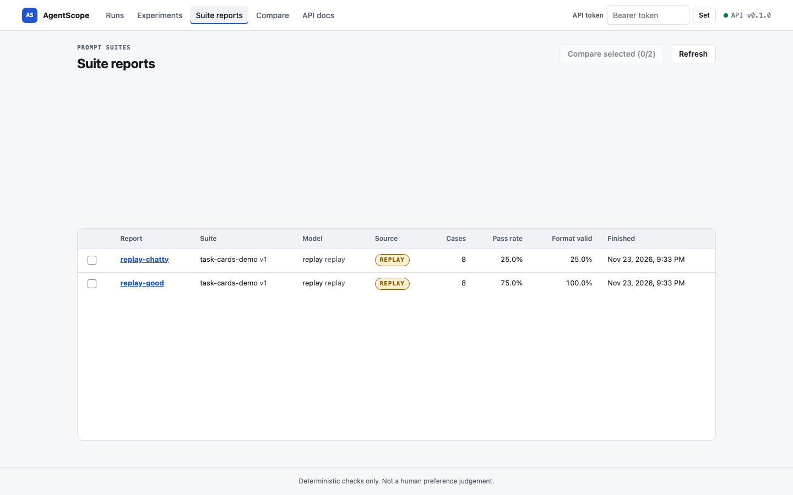
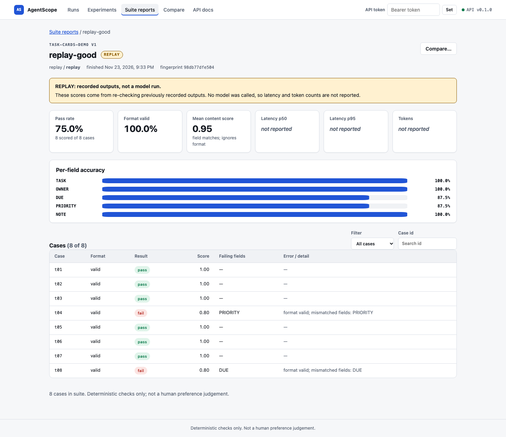
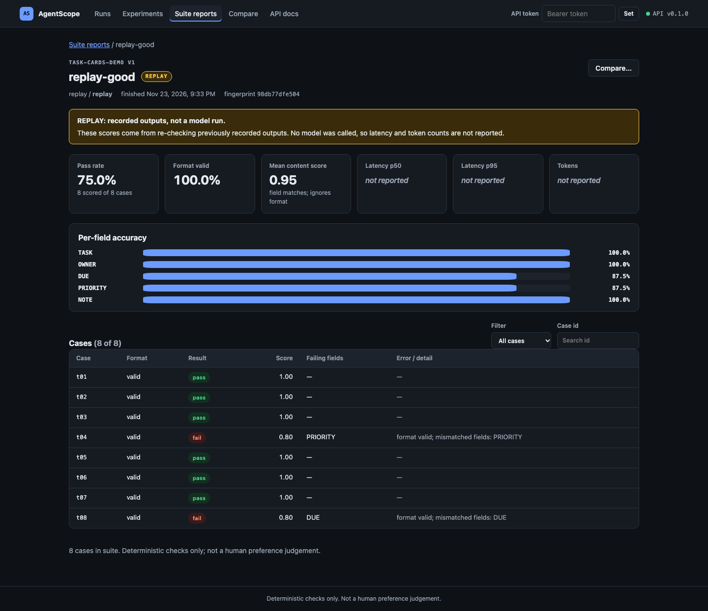
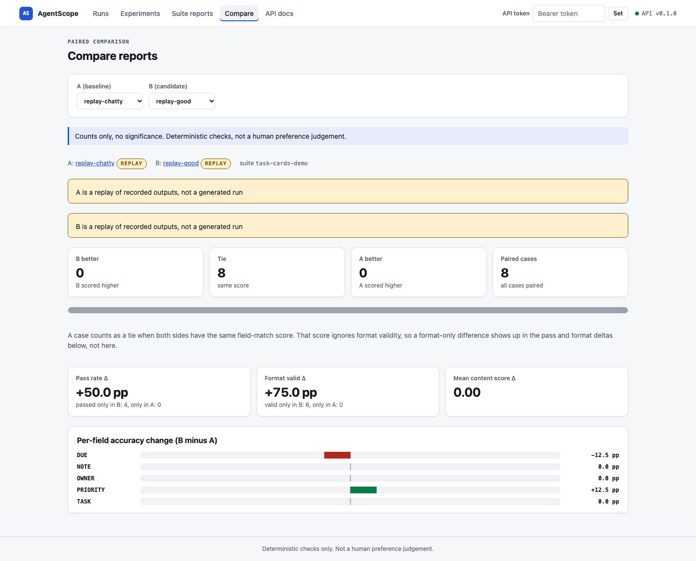

# Dashboard

The dashboard is a small React + Vite single-page app served by `agentscope serve` from
`agentscope/api/static/`. It has no UI framework and no runtime dependency beyond React.

| Page | What it shows |
|---|---|
| Suite reports | Every prompt-suite report found in the reports directory, with source, pass rate and format-valid rate. Tick two rows to compare them. |
| Report detail | Aggregate tiles, per-field accuracy chart, and a filterable per-case table. |
| Compare | Paired counts (B better / tie / A better), aggregate and per-field deltas. |
| Runs / Experiments | The original SWE-task views: run history with execution traces, and a form to queue an evaluation. |

## Run it

```bash
pip install -e '.[dev]'
agentscope suite run --suite examples/suites/task-cards/suite.yaml \
  --provider replay --replay-outputs examples/suites/task-cards/replay-good.outputs.jsonl \
  --out artifacts/suite-reports/replay-good
AGENTSCOPE_REPORTS_DIR=artifacts/suite-reports agentscope serve --sandbox local
# open http://127.0.0.1:8000/
```

`./scripts/start-dashboard.sh` does the same with sensible defaults. `--sandbox local` runs task
code on this machine; use it only for development.

### Reports directory

`AGENTSCOPE_REPORTS_DIR` (default `artifacts/suite-reports`) holds one sub-directory per report,
each containing the `results.json` that `agentscope suite run` writes. The directory name is the
report id. Folders whose `results.json` is missing, too large (over 8 MiB), unparsable, or of an
unsupported schema version are skipped in the list (with a logged warning) and return `422` when
fetched directly.

API routes (read-only, behind the same auth as the rest of `/api/`):

- `GET /api/v1/suite-reports`
- `GET /api/v1/suite-reports/{report_id}`
- `GET /api/v1/suite-compare?a=<id>&b=<id>[&allow_mismatch=true]`

Report ids must match `^[A-Za-z0-9][A-Za-z0-9_.-]{0,127}$`. Symlinked report directories or
`results.json` files are never followed, and the resolved file must stay inside the reports
directory.

### API token

When the server runs with `AGENTSCOPE_API_TOKEN`, every `/api/` call except `/api/v1/health`
needs `Authorization: Bearer <token>`. Enter the token in the **API token** field in the header.
It is kept in `sessionStorage` (cleared when the tab closes, never written to `localStorage`) and
sent as a Bearer header. Errors show the API's message and `request_id`.

### Development

```bash
cd frontend
npm ci
npm run dev        # Vite on :5173, proxies /api to 127.0.0.1:8000
npm run typecheck && npm test
npm run build      # writes ../agentscope/api/static (commit the result)
```

## Screenshots

> These screenshots show **REPLAY demo data** from `examples/suites/task-cards/` (recorded
> outputs re-scored by deterministic checks, synthetic task notes). They are not a model
> benchmark, and no model was called. Latency and tokens are "not reported" because replay
> records neither.

Suite reports list:



Report detail (light and dark follow `prefers-color-scheme`):




Compare (`replay-chatty` as A, `replay-good` as B):



The compare view reports counts only: no significance test, and deterministic checks rather than
a human preference judgement. In this example every case ties on field-match score, because the
chatty replay has the right content in the wrong format; that difference shows up in the pass and
format-valid deltas instead.

Reproduce:

```bash
for m in good chatty; do
  agentscope suite run --suite examples/suites/task-cards/suite.yaml --provider replay \
    --replay-outputs examples/suites/task-cards/replay-$m.outputs.jsonl \
    --out /tmp/reports/replay-$m
done
AGENTSCOPE_REPORTS_DIR=/tmp/reports agentscope serve --sandbox local
```
